# ArmForge: UR5e + Robotiq 2F-85 manipulation in native MuJoCo, learned with TQC-SAC + HER

**A real 6-DoF robot arm (Universal Robots UR5e from [MuJoCo Menagerie](https://github.com/google-deepmind/mujoco_menagerie)) with a real two-finger gripper (Robotiq 2F-85), simulated in a custom MuJoCo environment with friction cones, joint damping, force-limited position servos and a 4-bar gripper linkage - and a from-scratch PyTorch RL stack that learns reaching, pushing and pick-and-place from sparse rewards.** No Gymnasium, no toy kinematics: contacts and actuator limits are in the loop.


[](https://colab.research.google.com/github/rezaxr14/ArmLab_Robot_RL/blob/main/notebooks/armforge_control_panel.ipynb)

The whole project is driven from one notebook - [`notebooks/armforge_control_panel.ipynb`](notebooks/armforge_control_panel.ipynb): configure, inspect the scene, train, monitor, evaluate, render the *failing -> learning -> solved* media, and regenerate this README.

## Contents

1. [Results](#results)  2. [The robot and the physics](#the-robot-and-the-physics)  3. [How it learns](#how-it-learns)  4. [Run it](#run-it)  5. [Repository layout](#repository-layout)  6. [Limitations](#limitations)  7. [Licence](#license-and-third-party-assets)  8. [Legacy project](#legacy-armlab-rl-original-project)

## Results

### Reach

Move the Robotiq pinch point to a random 3D goal in the air. The warm-up task: it proves the controller, the contact-free dynamics and the learning stack work before objects are involved.

**Untrained policy: 0% success. After 60,000 steps: 100%** (deterministic policy, 30 held-out episodes at the *full* goal range, mean final goal distance 0.5 cm).

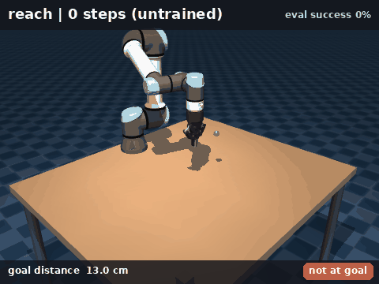

*One continuous clip: the same start/goal seeds replayed by policy snapshots from step 0 to the end of training.*

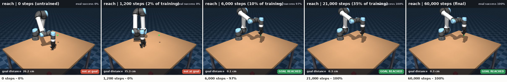

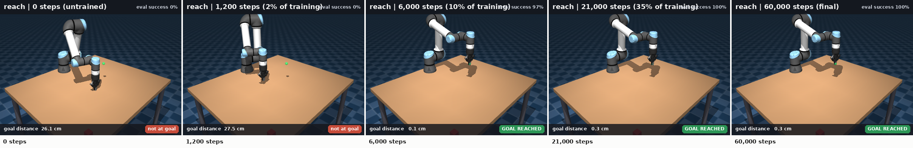

| snapshot (env steps) | stage | success | mean final distance |
|--:|:--|--:|--:|
| 0 | untrained | 0% | 23.7 cm |
| 1,200 | 2% of training | 0% | 30.8 cm |
| 6,000 | 10% of training | 97% | 0.7 cm |
| 21,000 | 35% of training | 100% | 0.5 cm |
| 60,000 | final | 100% | 0.5 cm |

*Each snapshot row is 30 held-out episodes: one success rate carries about +/-0 points (1 standard error).*


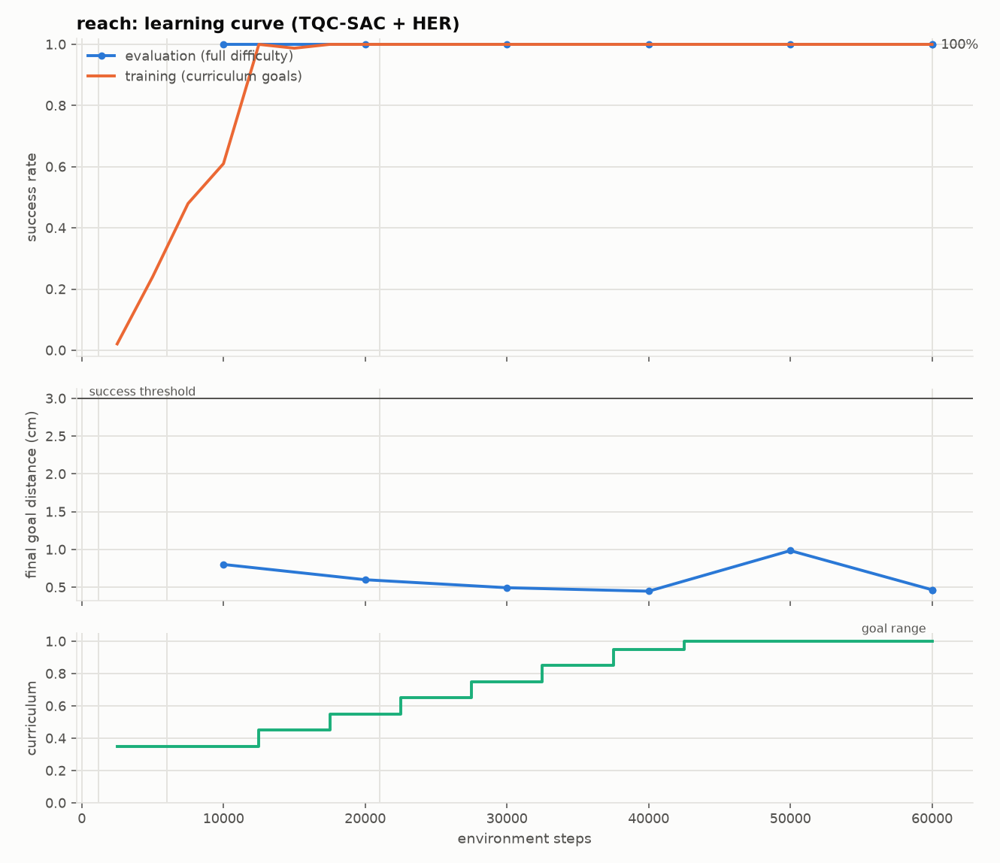

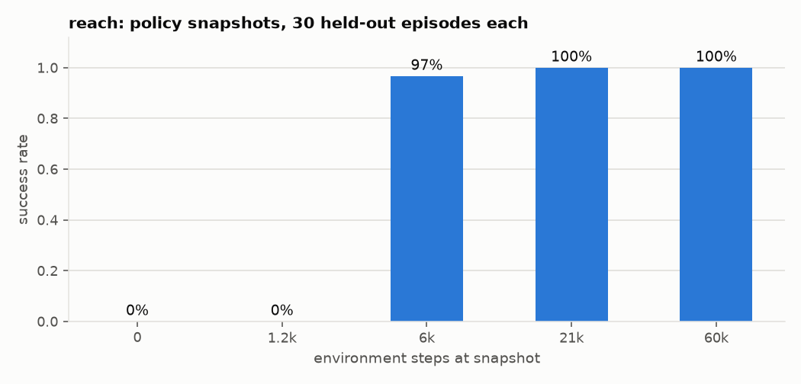

Run: 60,000 environment steps (1,200 episodes) in 44 min on `cuda`.

<details><summary>Per-snapshot clips</summary>

**0 steps (untrained)** - `hero` camera, 0% success

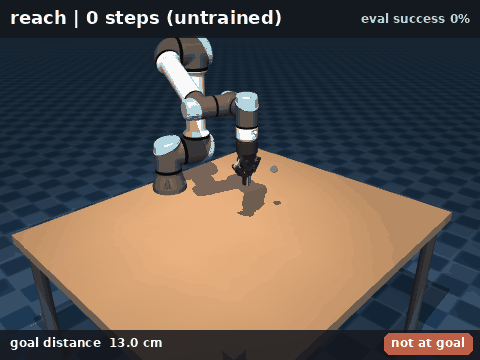

**1,200 steps (2% of training)** - `hero` camera, 0% success


**6,000 steps (10% of training)** - `hero` camera, 97% success


**21,000 steps (35% of training)** - `hero` camera, 100% success


**60,000 steps (final)** - `hero` camera, 100% success

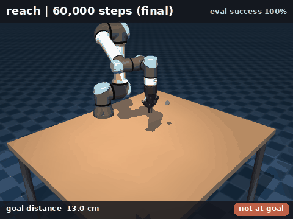

</details>

### Push

Slide a free 40 mm cube to a goal on the table with the **closed** gripper held 2 cm above the surface. The cube is moved only by contact friction, so sliding, torsional and rolling friction decide whether a push goes straight, spins the cube or tips it.

**Untrained policy: 0% success. After 200,000 steps: 43%** (deterministic policy, 30 held-out episodes at the *full* goal range, mean final goal distance 22.5 cm).

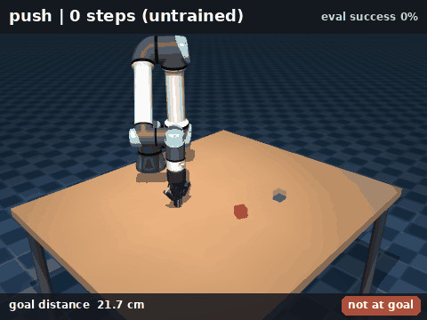

*One continuous clip: the same start/goal seeds replayed by policy snapshots from step 0 to the end of training.*

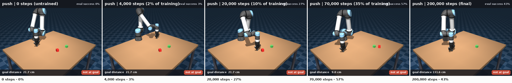

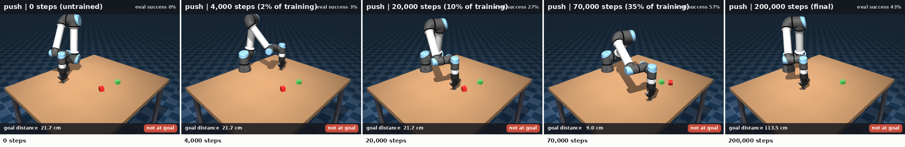

| snapshot (env steps) | stage | success | mean final distance |
|--:|:--|--:|--:|
| 0 | untrained | 0% | 16.3 cm |
| 4,000 | 2% of training | 3% | 15.6 cm |
| 20,000 | 10% of training | 27% | 14.8 cm |
| 70,000 | 35% of training | 57% | 7.2 cm |
| 200,000 | final | 43% | 22.5 cm |

*Each snapshot row is 30 held-out episodes: one success rate carries about +/-9 points (1 standard error).*


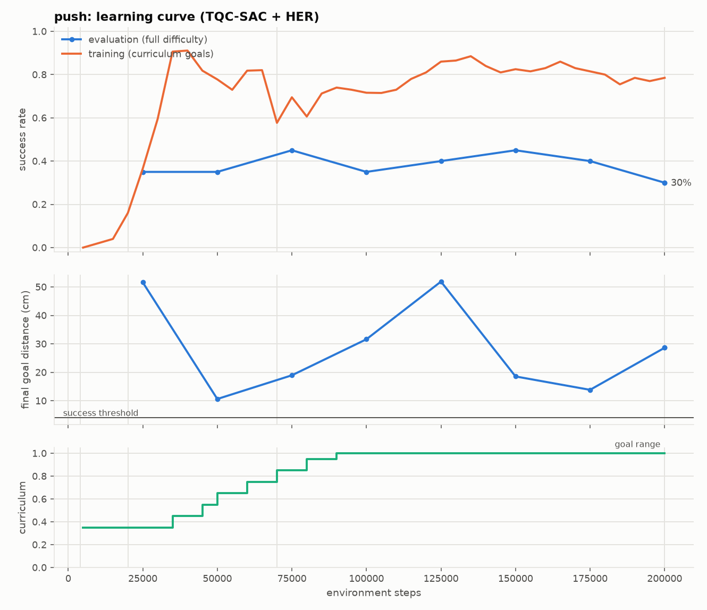

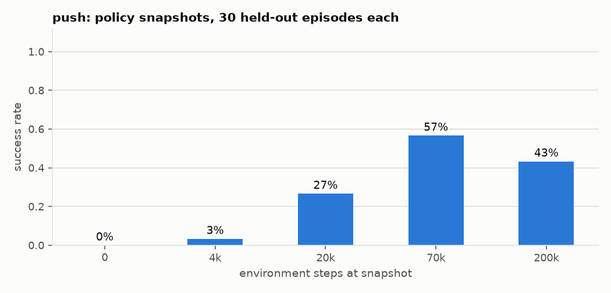

Run: 200,000 environment steps (2,287 episodes) in 127 min on `cuda`, plus 19,740 scripted demonstration steps.

<details><summary>Per-snapshot clips</summary>

**0 steps (untrained)** - `hero` camera, 0% success


**4,000 steps (2% of training)** - `hero` camera, 3% success

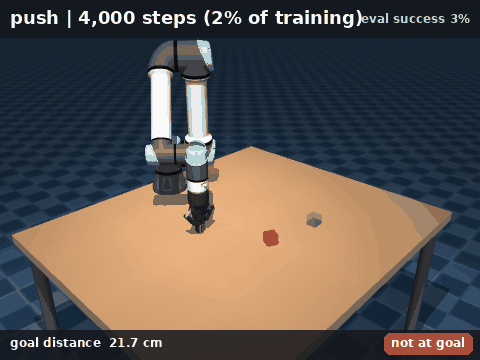

**20,000 steps (10% of training)** - `hero` camera, 27% success


**70,000 steps (35% of training)** - `hero` camera, 57% success

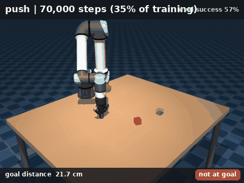

**200,000 steps (final)** - `hero` camera, 43% success

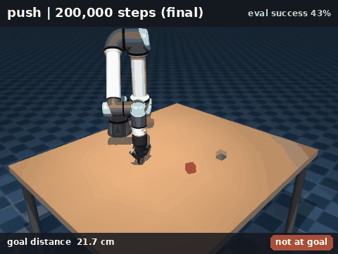

</details>

### Pick and place

Grasp the cube with the 2F-85, lift it, and put it at a goal on the table, in the air, or (in the cluttered variant) inside a walled tray among loose distractor cubes. Needs a real grasp: pad friction, finger linkage compliance and grip force all matter.

**Untrained policy: 0% success. After 200,000 steps: 37%** (deterministic policy, 30 held-out episodes at the *full* goal range, mean final goal distance 38.9 cm).


*One continuous clip: the same start/goal seeds replayed by policy snapshots from step 0 to the end of training.*

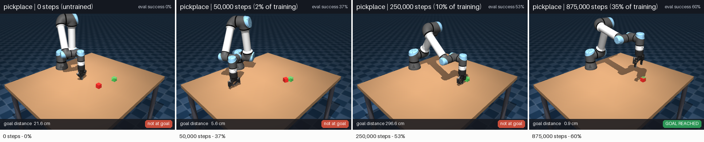

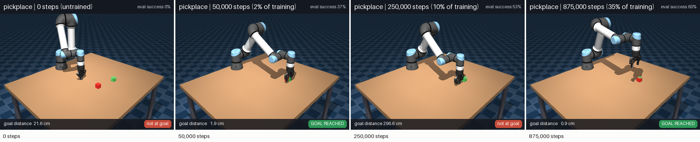

| snapshot (env steps) | stage | success | mean final distance |
|--:|:--|--:|--:|
| 0 | untrained | 0% | 16.6 cm |
| 4,000 | 2% of training | 0% | 16.5 cm |
| 20,000 | 10% of training | 30% | 14.2 cm |
| 70,000 | 35% of training | 40% | 9.6 cm |
| 200,000 | final | 37% | 38.9 cm |

*Each snapshot row is 30 held-out episodes: one success rate carries about +/-9 points (1 standard error).*


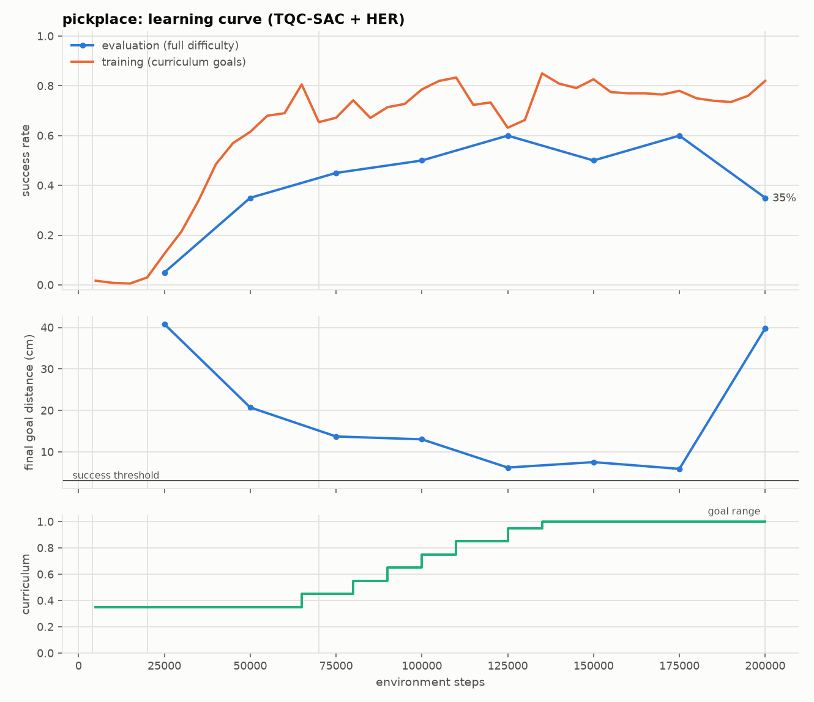

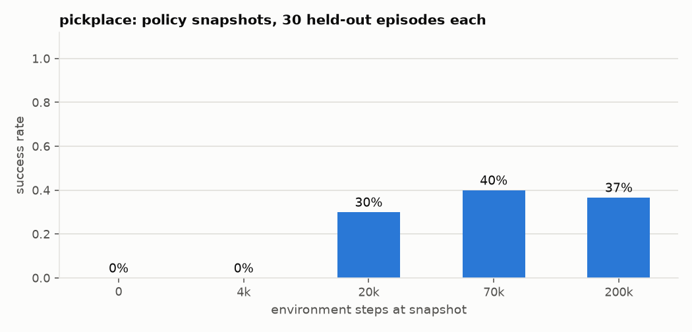

Run: 200,000 environment steps (1,916 episodes) in 127 min on `cuda`, plus 60,880 scripted demonstration steps.

<details><summary>Per-snapshot clips</summary>

**0 steps (untrained)** - `hero` camera, 0% success

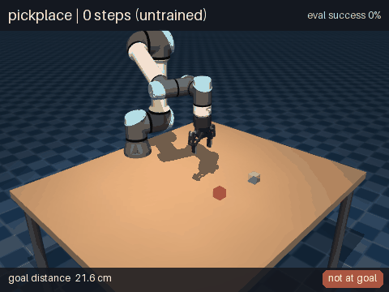

**4,000 steps (2% of training)** - `hero` camera, 0% success

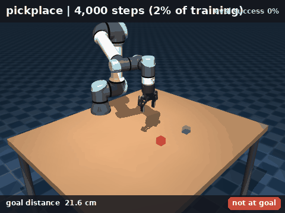

**20,000 steps (10% of training)** - `hero` camera, 30% success


**70,000 steps (35% of training)** - `hero` camera, 40% success

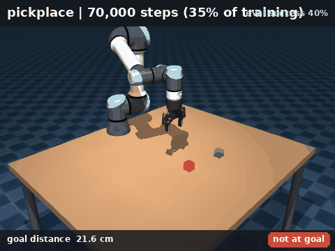

**200,000 steps (final)** - `hero` camera, 37% success


</details>

### Pick and place (cluttered)

The same grasp-and-place task in the hard scene: a walled tray as the place target, two loose distractor cubes that can be knocked around, and full domain randomisation.

**Untrained policy: 0% success. After 250,000 steps: 23%** (deterministic policy, 30 held-out episodes at the *full* goal range, mean final goal distance 29.0 cm).

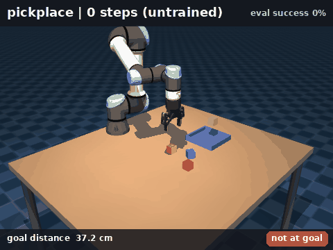

*One continuous clip: the same start/goal seeds replayed by policy snapshots from step 0 to the end of training.*

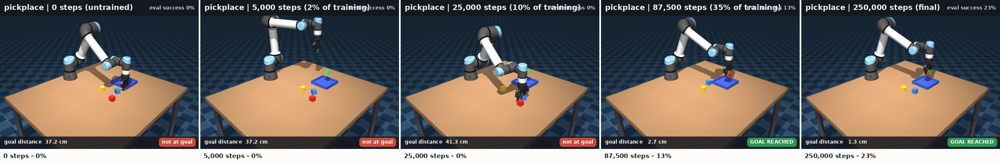

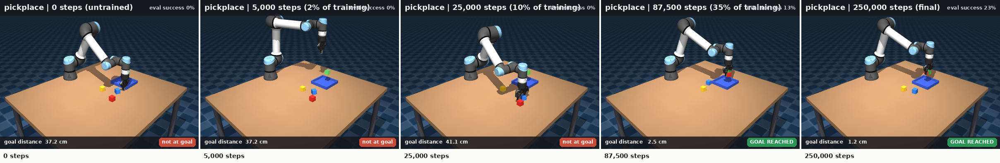

| snapshot (env steps) | stage | success | mean final distance |
|--:|:--|--:|--:|
| 0 | untrained | 0% | 30.7 cm |
| 5,000 | 2% of training | 0% | 30.8 cm |
| 25,000 | 10% of training | 0% | 38.7 cm |
| 87,500 | 35% of training | 13% | 27.3 cm |
| 250,000 | final | 23% | 29.0 cm |

*Each snapshot row is 30 held-out episodes: one success rate carries about +/-8 points (1 standard error).*


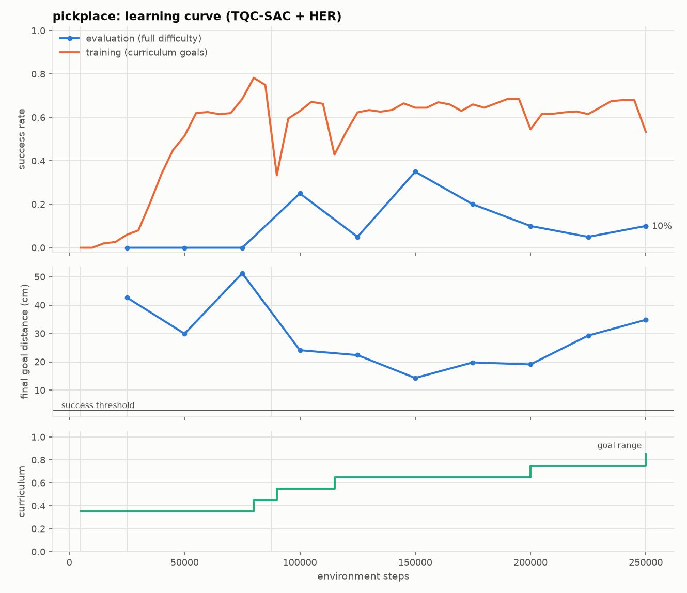

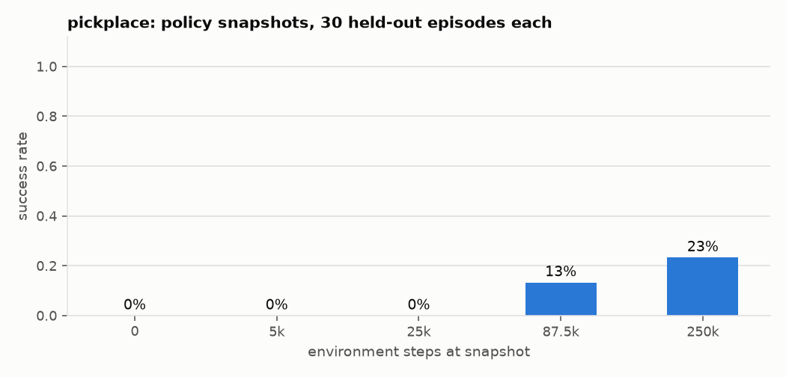

Run: 250,000 environment steps (1,929 episodes) in 137 min on `cuda`, plus 63,810 scripted demonstration steps.

<details><summary>Per-snapshot clips</summary>

**0 steps (untrained)** - `hero` camera, 0% success

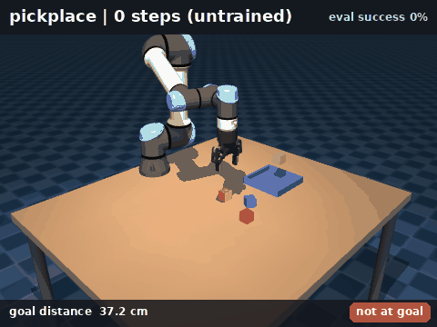

**5,000 steps (2% of training)** - `hero` camera, 0% success

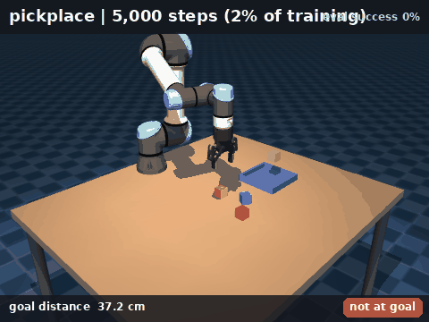

**25,000 steps (10% of training)** - `hero` camera, 0% success


**87,500 steps (35% of training)** - `hero` camera, 13% success

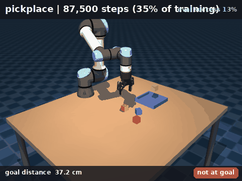

**250,000 steps (final)** - `hero` camera, 23% success


</details>

## The robot and the physics

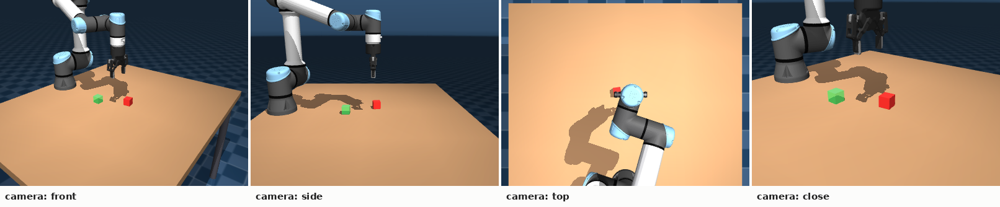

The scene is generated programmatically ([`scene.py`](src/armforge/scene.py)) from the pinned Menagerie models: the UR5e and 2F-85 XML are merged (names, classes, meshes and contact exclusions are namespaced), the gripper is mounted on the flange, and a table, optional walled tray, free cubes, a mocap goal marker and five cameras are added. The meshes are downloaded once into a cache (about 45 MB), not vendored.

| quantity | value |
|:--|:--|
| Simulator / integrator | MuJoCo, `implicitfast`, dt = 2 ms, 20 substeps per control step -> 25 Hz policy |
| Friction cone | `elliptic`, `impratio` 10 (no linearised-pyramid friction artefacts) |
| Table friction (sliding, torsional, rolling) | (0.5, 0.005, 0.0001) |
| Cube friction (sliding, torsional, rolling) | (0.6, 0.01, 0.0005); MuJoCo uses the per-component **max** of two touching geoms, so cube-on-table slides at mu = 0.6 |
| Gripper pad friction | 1 sliding, contact dimension 4 (adds torsional friction), pad priority overrides the cube's values |
| Cube | 40 mm, 80 g, `condim` 4 |
| Contact softness | `solref` (0.01, 1) (pads (0.01, 1)), `solimp` (0.95, 0.99, 0.001) |
| Arm actuators | UR5e position servos from Menagerie: kp 2000 / 500 N m/rad, force limits 150 / 28 N m; servo damping kd scaled x0.25 (the stock servo is over-damped: 0.2 s time constant) |
| Arm joint damping + Coulomb friction | 2 N m s/rad + 0.1 N m `frictionloss` on every joint (added on top of the model's armature) |
| Gravity | 9.81 m/s^2; the arm and gripper bodies are gravity-compensated (`arm_gravity_comp`, as the UR controller does on hardware) - the cube is not |
| Gripper | Robotiq 2F-85: 4-bar linkage with equality constraints, spring links, tendon-coupled actuator, 5 N force limit |
| Domain randomisation (optional) | friction x(0.7, 1.3), cube mass x(0.7, 1.4), joint damping x(0.7, 1.5), actuator kp x(0.85, 1.15) |
| Episode | 50 control steps = 2 s of simulated time; success radius 3 cm |

**Control.** The policy outputs a Cartesian displacement of the gripper's pinch point (up to 2.5 cm per step) and, for pick-and-place, a gripper command. Damped-least-squares differential IK holds the tool pointing straight down and turns that into joint targets for the arm's *actual* PD servos - so actuator lag, torque saturation, gravity and contact loads act on every motion; nothing is teleported.

**Observation** (goal-conditioned): pinch position and velocity, gripper opening, six joint angles and velocities, and - for object tasks - cube position, cube relative to the hand, orientation, linear/angular velocity, and left/right pad contact flags. The desired and achieved goals are separate vectors, which is what hindsight relabelling needs.

## How it learns

| component | setting |
|:--|:--|
| Algorithm | SAC with truncated quantile critics (TQC); `critic: twin` gives classic clipped double-Q SAC for ablations |
| Critic | 5 critics x 25 quantiles, drop top 2 per critic, LayerNorm = True |
| Networks | MLP (256, 256, 256) for actor and critics, tanh-Gaussian policy, automatic temperature |
| Hindsight replay | `future` strategy, relabel probability 0.8, sparse reward {-1, 0} |
| Bootstrap | gamma 0.98, targets clipped to the reachable return range, no bootstrap cut at the time limit |
| Optimisation | Adam 0.0003, batch 1024, 0.5 gradient steps per environment step, soft target update tau 0.005 |
| Curriculum | goals start near the object and spread out only as the rolling success rate rises; **evaluation always uses the full goal range** |
| Demonstrations (optional) | scripted experts seed the replay buffer and warm-start the actor by behaviour cloning |

```text
  N parallel MuJoCo workers  --episodes-->  episode buffer (GPU)  --(s, a, goal)-->  TQC-SAC
        ^                                       |  HER: replace goal with an achieved future state, recompute reward
        |                                       v
   policy (actor)  <------------------ gradient updates (UTD ratio)      curriculum widens goals on success
```

Why these pieces: sparse rewards give no signal until the arm happens to succeed, so **HER** turns every failed episode into a success for the goal it actually reached; **TQC** curbs the value over-estimation that makes sparse-reward off-policy RL diverge; the **curriculum** keeps goals near enough to hit by accident at first; **scripted demonstrations** (optional) give pick-and-place a first successful grasp to learn from.

## Run it

**Colab (GPU):** open the badge above, `Runtime -> Change runtime type -> GPU`, then *Run all* and edit the form fields in the *Configure* cell.

**Local:**

```bash
git clone https://github.com/rezaxr14/ArmLab_Robot_RL.git && cd ArmLab_Robot_RL
python -m pip install -e ".[dev]"          # numpy, mujoco, torch, imageio, matplotlib, ...
armforge doctor                               # checks mujoco, torch/CUDA, rendering and the Menagerie download
armforge scene --task pickplace --out docs/media/scene_gallery.png
armforge pack --run runs/reach-demo           # zip a run's checkpoints + media
armforge fk-check                             # CPU (numpy) forward kinematics vs MuJoCo's FK: should agree to ~1e-9 m
armforge train --config configs/reach.yaml --name reach-demo
armforge publish --run runs/reach-demo        # GIFs, stills, curves -> docs/media/ ; then: armforge readme
```

Config presets live in [`configs/`](configs/) (`reach`, `push`, `pickplace`, `pickplace_clutter`, `smoke`); any field can be overridden with `--set train.total_steps=500000 env.physics.pad_friction=0.8`. Rendering needs an OpenGL backend: EGL by default on headless Linux (`MUJOCO_GL=osmesa` for software rendering).

## Repository layout

```text
src/armforge/   config, scene (MJCF composition), kinematics oracle + fkcheck (CPU FK vs MuJoCo), env/ (MuJoCo env, tasks, controller, vec),
                rl/ (agent, networks, HER buffer, trainer, experts), media, report, readme, cli
configs/        run presets
notebooks/      armforge_control_panel.ipynb - the control panel
tests/          pure-python tests + simulator/torch tests (skipped when those packages are absent)
docs/media/     generated GIFs, stills and plots shown above
legacy/         the previous ArmLab project, moved here unchanged (see the section at the bottom)
```

## Limitations

- Simulation only; no sim-to-real claim. Domain randomisation is provided, but transfer has not been tested.
- The tool orientation is held fixed (pointing down), so grasps are top-down; no wrist-yaw control, so cubes are spawned within +/-0.35 rad of the gripper axis for pick-and-place.
- Success is the cube/pinch within a radius of the goal (position only, not orientation).
- Results are single-seed unless you run more seeds; one seed is not a benchmark.
- Defaults (1,000,000-step budget, 4 workers) are sized for a single Colab GPU session and have not been tuned.

## License and third-party assets

ArmForge is MIT-licensed (see `pyproject.toml`). The UR5e and Robotiq 2F-85 models come from [MuJoCo Menagerie](https://github.com/google-deepmind/mujoco_menagerie) (both are BSD-style licensed from ROS-Industrial; each model folder carries its own `LICENSE`). They are **downloaded at first use, pinned to a commit, and not redistributed** in this repository. MuJoCo is Apache-2.0; PyTorch, NumPy, Pillow, Matplotlib and imageio keep their own licences. Design notes: [`docs/design.md`](docs/design.md).


---

# Legacy: ArmLab RL (original project)

> **Everything below is the original project, kept intact.** The code moved from the repository
> root into [`legacy/`](legacy/); relative links below were re-pointed there, but the commands in
> code blocks are unchanged - run them from inside `legacy/` (e.g. `cd legacy && pip install -e .`).
> The legacy README is reproduced verbatim after this line.

# ArmLab RL — 3D Robot Arm Control with Analytical IK and Reinforcement Learning

**A reproducible RL and control suite for a 3-link robot arm in 3D. It puts a
precise analytical inverse-kinematics (IK) solver, classical controllers (PD,
damped-least-squares Jacobian, MPC, RRT) and modern RL agents (Dueling Double
DQN and SAC) on the same task, robot model and evaluation schema — in
kinematics and, optionally, MuJoCo physics.**

The project grew out of two original 3D robot-arm demos: an analytical IK
solver and a Dueling Double DQN agent. The engineering goal here is narrower
and more useful: keep the math correct and tested, make RL training
reproducible and checkpointed, and make every controller comparable through one
measured, versioned results format.

> **Scope:** the classical comparison is a **20-episode smoke suite** and the
> GPU RL runs are **single-seed**; neither is a converged multi-seed benchmark.
> Every number below comes from a saved run directory. See
> [`docs/experiments.md`](legacy/docs/experiments.md) for the protocol and failure
> analysis.

---

## Demo

The original demonstration still runs and shows analytical IK tracking a moving
target and a trained DQN reaching goals:

[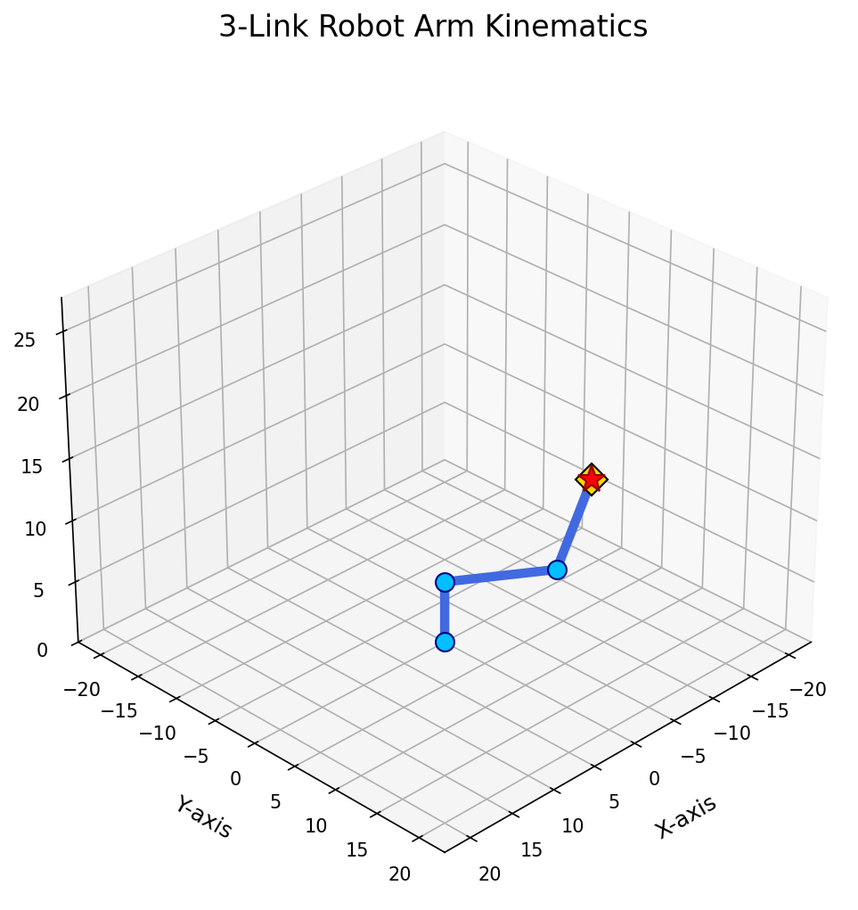](https://youtu.be/OU_E-vsCCfU "Robot arm demo")

| Analytical IK tracking | RL reaching |
|:--:|:--:|
|  | 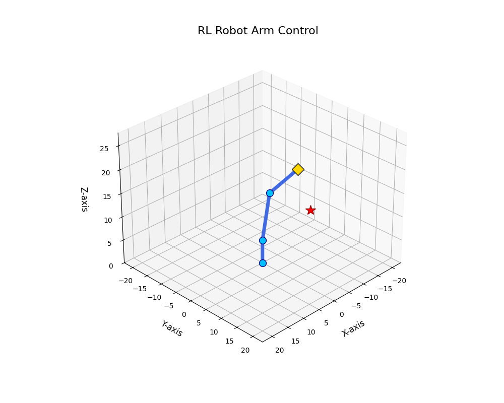 |
| 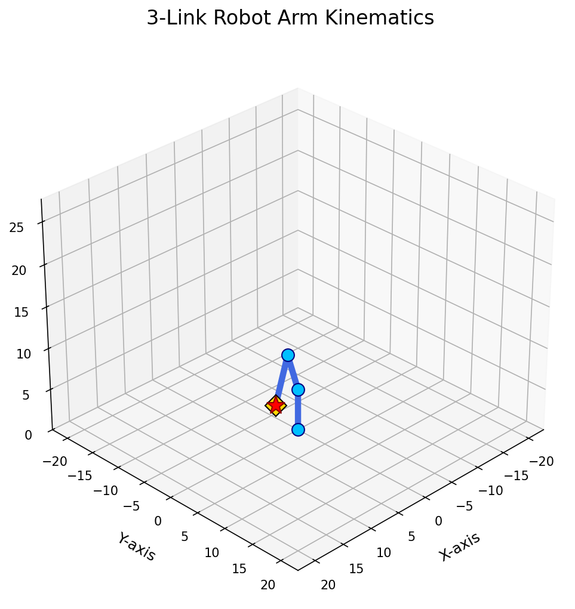 | 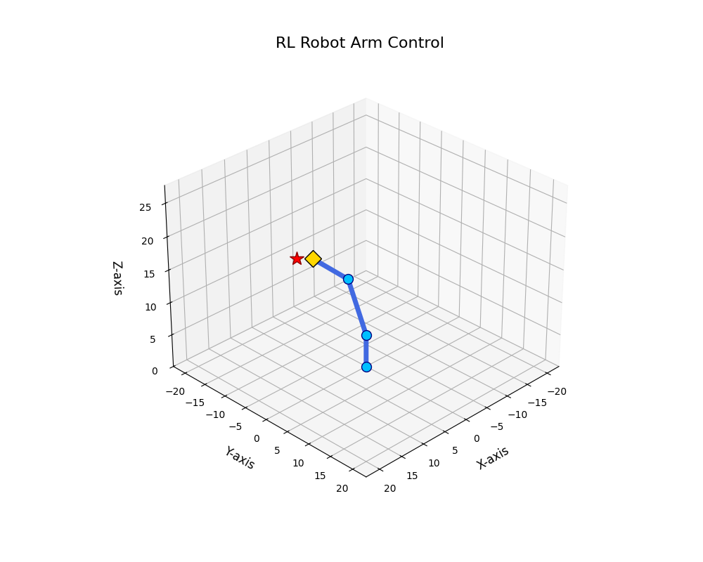 |

Reproducible headless runs also generate their own plots and trajectory
artifacts (see the results section).

## Repository layout

The repository is deliberately split into three sections:

| section | location | what it is |
|:--|:--|:--|
| **1. Analytical inverse kinematics** | [`projects/analytical_inverse_kinematics/`](legacy/projects/analytical_inverse_kinematics/) | the original 3-link analytical-IK demo, kept runnable and verified to round-trip reachable targets |
| **2. RL Double Dueling DQN** | [`projects/rl_double_dueling_dqn/`](legacy/projects/rl_double_dueling_dqn/) | the original from-scratch DQN demo, training script and saved model |
| **3. ArmLab benchmark** | [`src/armlab/`](legacy/src/armlab/) | the integrated, tested package: correct kinematics, classical controllers, DQN/SAC, physics, evaluation and artifacts |

The two historical demos stay runnable for provenance and are covered by
regression tests. Their corrected APIs live in
[`armlab.legacy`](legacy/src/armlab/legacy/), so new code can use them without copying
the old scripts. See [`projects/README.md`](legacy/projects/README.md) for exact run
commands.

```text
projects/
  analytical_inverse_kinematics/   # section 1
  rl_double_dueling_dqn/           # section 2
  screenshots/                     # original demo media
  README.md
src/armlab/                        # section 3 (integrated benchmark)
configs/  tests/  docs/  scripts/  # support for section 3
```

### Training and rollout figures (generated from real run artifacts)

The images below are rendered by
[`scripts/make_readme_assets.py`](legacy/scripts/make_readme_assets.py) from the
recorded `training_metrics.json`, `sac_metrics_seed*.json`, `trajectory_*.npz`
and benchmark summaries — they are not mockups or hand-drawn diagrams.

| DQN training (RTX 4050, seed 7) | SAC training (RTX 4050, seed 7) |
|:--:|:--:|
| 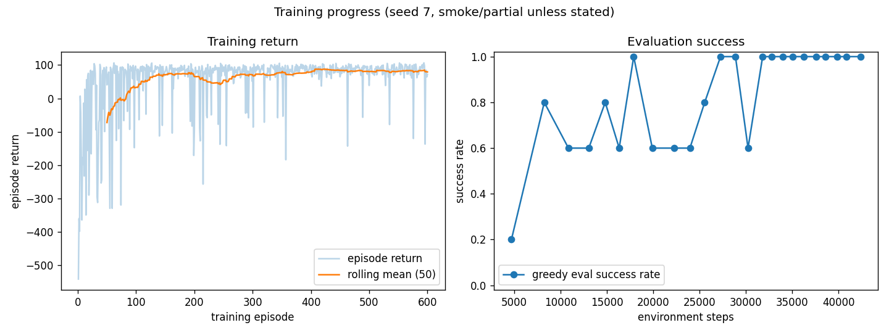 | 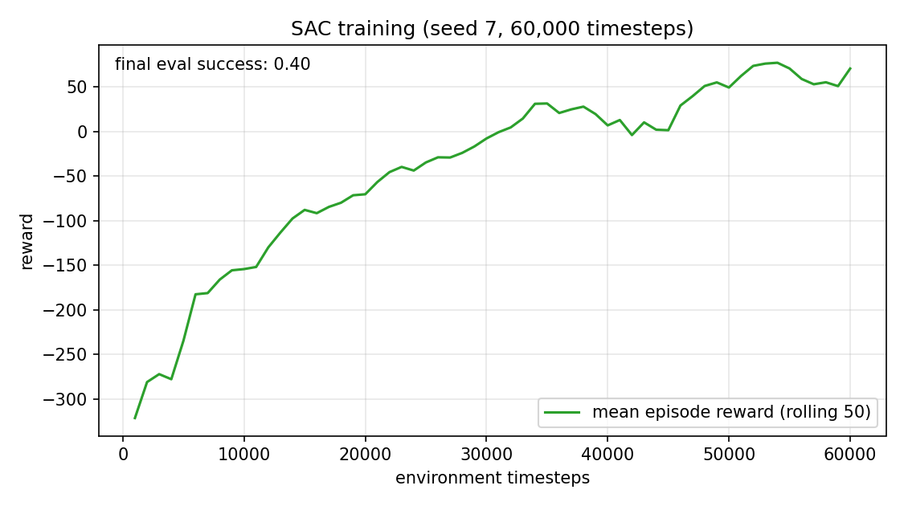 |

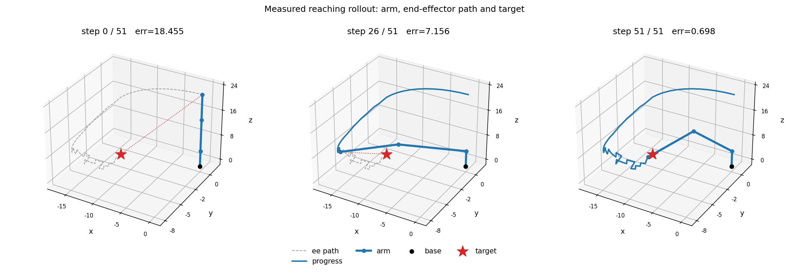

Three panels (start / midpoint / final) of a held-out episode (`seed=100009`)
executed by the trained DQN checkpoint. Final end-effector error is `0.698`
legacy units and the episode succeeds; the dashed line is the complete recorded
end-effector path.

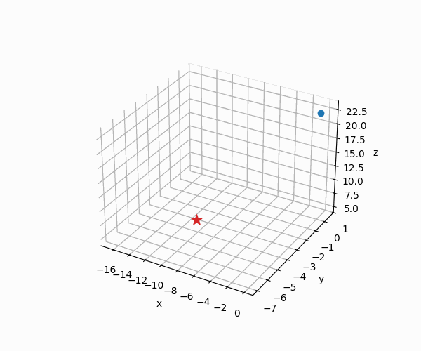

Classical smoke benchmark across 16 scenario/controller cells (20 episodes
each):

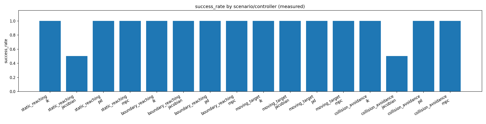

---

## What is implemented

- **Correct, tested kinematics.** One `RobotKinematics` source of truth for FK,
  analytical IK (both elbow branches, closest-branch selection, joint limits,
  reachability, singular cases), the geometric Jacobian and damped least
  squares.
- **Classical controllers.** Analytical IK + joint P/PD tracking, resolved-rate
  damped-least-squares Cartesian control, random-shooting MPC, and an
  RRT-Connect path planner tracked by a low-level controller.
- **Gymnasium environments.** Discrete (`ArmLabKinematic-v0`) and continuous
  (`ArmLabKinematicContinuous-v0`) reaching, a moving-target environment, and
  seeded, reachable target sampling. Seeded resets, joint-limit containment,
  `terminated` vs `truncated` semantics, reward components in `info`, and
  `check_env` coverage.
- **Dueling Double DQN from scratch.** Target-network initialization/freezing,
  Double-DQN target selection, seeded replay buffer, soft/hard target updates,
  gradient clipping, full resumable checkpoints and CSV/JSON training metrics.
- **SAC baseline via Stable-Baselines3** on the continuous-action task, with
  saved model + evaluation metrics and deterministic evaluation.
- **MuJoCo physics (optional).** Programmatically generated 3-link MJCF,
  velocity actuators, joint limits, contact detection, deterministic reset, and
  a test that the MuJoCo end-effector site agrees with analytical FK.
- **Named scenarios.** `static_reaching`, `boundary_reaching`, `moving_target`,
  `collision_avoidance`, all seeded and held out from training.
- **Standardized evaluation + artifacts.** Schema-1.0 run directories with
  `metadata.json`, `episodes.csv`, `summary.json`, `metrics.csv` and NPZ
  trajectories; plots and reports generated only from saved data.
- **CLI, replay and optional dashboard.** `python -m armlab` with `doctor`,
  `demo`, `train`, `evaluate`, `benchmark`, `report`, `replay` and `dashboard`.
- **Tests and CI.** 200+ deterministic tests that run on CPU without a
  display; GitHub Actions for base + optional physics.

### Not implemented (do not assume it exists)

- A **final** multi-seed benchmark (≥5 training seeds × ≥100 held-out episodes).
  The current results are a 20-episode classical smoke suite plus single-seed
  GPU RL runs.
- Robustness scenarios beyond held-out targets: `perturbed_dynamics`,
  `sensor_noise_delay`, `unseen_targets` are not wired into the scenario
  registry yet.
- **Complete obstacle-aware control.** The DLS controller has an optional
  end-effector repulsion and RRT plans against obstacles, but IK/PD/MPC and the
  RL policies do not observe obstacles, and RRT is not in the default suite.
- Six-DOF/UR5e models, grippers, pick-and-place, ROS 2 or hardware control, and
  any sim-to-real claim.
- Vectorized/multi-process training and hosted experiment tracking.
- A browser-hosted simulator.

---

## Architecture

```text
configs/*.yaml ──► configio ──► frozen dataclasses (config.py)
                                      │
                    ┌─────────────────┴──────────────────┐
                    ▼                                    ▼
             kinematics.py                        controllers/  (classical)
        (FK / IK / Jacobian / DLS)                        │
                    │                                     │
                    ▼                                     ▼
             envs/ (Gymnasium) ◄──────────── rl/ (DQN, SAC)
                    │
                    ▼
     evaluation/runner + metrics + benchmark
                    │
                    ▼
     results/<run-id>/{metadata,episodes,summary,metrics,trajectory}
                    │
          ┌─────────┴──────────┐
          ▼                    ▼
   evaluation/plots.py   visualization/replay, dashboard
```

Every environment, controller, planner, metric and visualizer uses the same
`RobotKinematics`; no module re-derives link positions. Optional dependencies
(MuJoCo, Stable-Baselines3, Dash/Plotly) are imported lazily. Full details:
[`docs/architecture.md`](legacy/docs/architecture.md).

---

## Installation

```bash
git clone https://github.com/rezaxr14/ArmLab_Robot_RL.git
cd ArmLab_Robot_RL
python -m venv .venv

# Linux/macOS
source .venv/bin/activate
# Windows PowerShell
# .\.venv\Scripts\Activate.ps1

python -m pip install --upgrade pip
python -m pip install -e ".[dev]"
```

Optional extras:

```bash
python -m pip install -e ".[rl]"        # torch + Stable-Baselines3 (SAC)
python -m pip install -e ".[physics]"   # MuJoCo
python -m pip install -e ".[ui]"        # Dash + Plotly dashboard
```

The base install needs no GPU, display, MuJoCo or Dash.

---

## Quick start (commands tested on this checkout)

```bash
# Environment / optional-dependency report
python -m armlab doctor

# Headless demos
python -m armlab demo ik --headless --trials 5
python -m armlab demo physics --headless --steps 20   # requires physics extra

# Evaluate a controller; writes a run directory under results/
python -m armlab evaluate --scenario static_reaching --controller ik --episodes 5
python -m armlab evaluate --scenario static_reaching --controller jacobian --episodes 5

# Smoke training (not convergence)
python -m armlab train dqn --episodes 20 --max-steps 2000 --eval-every 5 --seed 7
python -m armlab train sac --total-timesteps 2000 --seed 7

# Evaluate a saved RL checkpoint
python -m armlab evaluate --scenario static_reaching --controller dqn \
  --checkpoint results/train_dqn_seed7/latest.pt --episodes 5

# Benchmark + reports + replay
python -m armlab benchmark --suite default --config configs/benchmark/default.yaml
python -m armlab report --run results/<run-id>
python -m armlab replay --run results/<run-id> --episode 0

# Optional dashboard
python -m armlab dashboard --results results
```

All paths are relative to the current working directory.

---

## Controllers

| name | type | summary |
|:--|:--|:--|
| `ik` | classical | analytical IK branch + bounded joint P control |
| `pd` | classical | analytical IK target + joint PD tracking |
| `jacobian` | classical | resolved-rate damped least squares on Cartesian error; clips steps and projects onto joint limits |
| `mpc` | classical | random-shooting MPC over a short horizon on the kinematic model |
| `rrt` | classical | RRT-Connect joint-space path, then tracked by a low-level controller |
| `dqn` | learned | from-scratch Dueling Double DQN, discrete joint increments |
| `sac` | learned | Stable-Baselines3 SAC, continuous bounded joint increments |

Classical controllers are evaluated in the **continuous** environment so their
true bounded commands are used. DQN and SAC keep their native action spaces.

Math reference (frames, FK/IK equations, Jacobian, damping, reward):
[`docs/mathematical_conventions.md`](legacy/docs/mathematical_conventions.md).

---

## Measured results (smoke suite — not a final benchmark)

Command:

```bash
python -m armlab benchmark --suite default \
  --config configs/benchmark/default.yaml \
  --output-dir results/smoke-default
```

Kinematic task, 20 held-out episodes per cell, `base_eval_seed = 100000`,
success threshold `1.0` legacy unit. `mean final error` is in the same legacy
units.

| scenario | controller | success | mean final error |
|:--|:--|--:|--:|
| static_reaching | ik | 1.00 | 0.635 |
| static_reaching | jacobian | **0.50** | 2.803 |
| static_reaching | pd | 1.00 | 0.684 |
| static_reaching | mpc | 1.00 | 0.774 |
| boundary_reaching | ik | 1.00 | 1.045 |
| boundary_reaching | jacobian | 1.00 | 2.905 |
| boundary_reaching | pd | 1.00 | 1.152 |
| boundary_reaching | mpc | 1.00 | 0.693 |
| moving_target | ik | 1.00 | 0.022 |
| moving_target | jacobian | 1.00 | 1.086 |
| moving_target | pd | 1.00 | 0.024 |
| moving_target | mpc | 1.00 | 0.013 |
| collision_avoidance | ik | 1.00 | 0.635 |
| collision_avoidance | jacobian | **0.50** | 2.803 |
| collision_avoidance | pd | 1.00 | 0.684 |
| collision_avoidance | mpc | 1.00 | 0.774 |

Generated plots: `results/smoke-default/benchmark_success.png` and
`results/smoke-default/benchmark_errors.png`.

### GPU-trained RL policies (single seed — still not a final benchmark)

Trained on an NVIDIA RTX 4050 Laptop GPU (`torch 2.11.0+cu128`,
Stable-Baselines3 2.9.0) with `--device cuda`.

| policy | budget | greedy training-time eval | held-out eval (`base_eval_seed=100000`) |
|:--|:--|--:|--:|
| Dueling Double DQN | 600 episodes / 42,357 env steps / 332 s | 1.00 | **0.70 (7/10)** |
| SAC | 60,000 timesteps / 2,174 s | — (no intermediate eval) | **0.40 (4/10)** |

The DQN checkpoint was re-evaluated through the standard interface on a separate
10-episode held-out suite:

```bash
python -m armlab evaluate --scenario static_reaching --controller dqn \
  --checkpoint results/gpu/dqn/train_dqn_seed7/latest.best \
  --episodes 10 --seed 7 --output-dir results/gpu/eval-dqn --final
```

SAC was evaluated deterministically after training on the same held-out seed
block: **0.40 (4/10)**, mean final error `1.311`. Its rolling reward rose from
about `-321` to `+70`, so it is learning but is clearly less sample-efficient
than the discrete DQN here.

The gap between the DQN's 1.00 training-time greedy evaluation and its 0.70
held-out suite is reported rather than hidden. One seed per algorithm is **not**
the planned final benchmark (≥5 seeds × ≥100 episodes) and no convergence claim
is made.

### Failure case worth showing

The Jacobian/DLS controller succeeds only half the time on static and
collision-avoidance seeds. It is a local method: a joint can reach a limit while
the Cartesian error still points through that limit, so the projected update
stalls just outside tolerance. The collision-avoidance run still records 3
approximate obstacle penetrations.

**Obstacle avoidance is partial, not solved.** The `collision_avoidance`
scenario places two spheres and the metrics count capsule penetrations. The DLS
controller's optional end-effector repulsion is enabled, and RRT plans against
the obstacles, but IK/PD/MPC and the RL policies do not observe the obstacles.
RRT is available but is not part of the default smoke suite. This is reported
rather than tuned away; see [`docs/experiments.md`](legacy/docs/experiments.md) for the
analysis and possible fixes (limit-avoidance/null-space term, stall re-seeding).

RL smoke runs (2,000-step budgets, CPU) reached 0.00 eval success — expected for
undertrained agents. They are retained to prove the train → checkpoint → load →
evaluate path, not to claim learning. The larger GPU-trained runs above are
separate; the DQN checkpoint reaches **0.70** on its held-out suite. Full
details in [`docs/experiments.md`](legacy/docs/experiments.md).

---

## Reproduce the results

```bash
python -m pip install -e ".[dev]"
python -m pytest
python -m armlab benchmark --suite default \
  --config configs/benchmark/default.yaml --output-dir results/smoke-default
python -m armlab report --results results/smoke-default
```

A real benchmark requires editing `configs/benchmark/default.yaml`
(`smoke: false`, more episodes/seeds) and substantially more compute.

---

## Limitations

- Lengths use the legacy unit system (`link_lengths = [5, 10, 8]` treated as
  metres). `legacy_unit_scale_m: 0.1` documents the intended SI mapping but is
  **not applied**; changing it would silently alter every existing number.
- Physics parameters (masses, inertia, damping) are illustrative, not measured.
- Collision checks in the kinematic benchmark are approximate capsule tests,
  not MuJoCo contacts.
- The DLS controller has the documented local-minimum failure; MPC and IK/PD do
  not on these seeds.
- The dashboard requires the `ui` extra and is not covered by the local test
  run (its test skips when Dash/Plotly are absent).
- No sim-to-real, hardware, grasping or six-DOF claims.

---

## Project structure

```text
src/armlab/                  # section 3: integrated benchmark package
configs/                     # validated robot/env/train/benchmark YAML
tests/                       # deterministic unit + integration + regression tests
docs/                        # architecture, conventions, experiments, troubleshooting
docs/assets/                 # generated README figures
scripts/                     # reproducibility helpers (README asset generation)
projects/                    # sections 1-2: original demos + their screenshots
.github/workflows/           # CI
```

---

## Testing and contributing

```bash
python -m pytest
python -m ruff check src tests
python -m ruff format --check src tests
```

See [`CONTRIBUTING.md`](legacy/CONTRIBUTING.md) for setup, conventions and how to add
controllers/scenarios. Tests that need optional dependencies skip cleanly when
those packages are absent.

---

## License and attribution

The project is distributed under the MIT license (`pyproject.toml`). MuJoCo,
PyTorch, Stable-Baselines3, Gymnasium and Dash/Plotly remain under their own
licenses. No third-party robot meshes are redistributed; the MuJoCo model is
generated from configuration.
